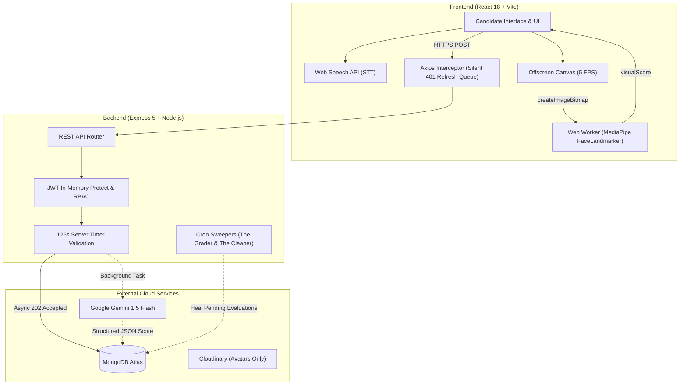

<div align="center">

# 🎙️ MockMate

**Next-Generation AI Technical & Behavioral Mock Interview Platform**

[](https://react.dev/)
[](https://vitejs.dev/)
[](https://nodejs.org/)
[](https://expressjs.com/)
[](https://www.mongodb.com/)
[](https://ai.google.dev/)
[](https://developers.google.com/mediapipe)
[](https://tailwindcss.com/)

<p align="center">
  Simulate realistic, high-pressure technical and behavioral interviews with real-time speech-to-text, edge AI facial composure tracking, and asynchronous multi-dimensional grading powered by Gemini 1.5 Flash.
</p>

</div>

---

## 📌 Table of Contents

- [Overview](#-overview)
- [Key Features](#-key-features)
- [System Architecture](#-system-architecture)
- [Scoring Weight Matrix](#-scoring-weight-matrix)
- [Question Bank & Taxonomy](#-question-bank--taxonomy)
- [Tech Stack](#-tech-stack)
- [Repository Structure](#-repository-structure)
- [Quick Start Guide](#-quick-start-guide)
- [Environment Configuration](#-environment-configuration)
- [Automated Testing & QA Matrix](#-automated-testing--qa-matrix)
- [Security & Perimeter Architecture](#-security--perimeter-architecture)

---

## 🌟 Overview

**MockMate** is an enterprise-grade MERN-stack mock interview platform designed to bridge the gap between candidate preparation and real-world hiring assessments.

Unlike naive mock interview apps that record audio/video and incur massive cloud storage costs, MockMate operates with **zero server-side audio/video processing**:
1. Speech is transcribed in real time on the client using the native **Web Speech API**.
2. Facial composure, yaw divergence, and eye engagement are tracked client-side at 60+ FPS inside a **dedicated Web Worker** using **Google MediaPipe Face Landmarker** with WebGL hardware acceleration (`delegate: "GPU"`).
3. Transcripts and telemetry are submitted via an **asynchronous fire-and-forget** REST pipeline to Node.js.
4. **Gemini 1.5 Flash** evaluates answers against strict XML-delimited rubrics and outputs validated JSON score breakdowns.

---

## 🚀 Key Features

### 1. 🛡️ Client-Side Edge AI Telemetry (MediaPipe)
- Operates inside an isolated Web Worker (`faceLandmarker.worker.js`) to guarantee the main React UI thread never drops a frame (measured at **62 FPS**).
- Computes real-time yaw divergence from camera center and eye engagement at ~5 FPS using zero-copy `ImageBitmap` transfers.
- Computes a rolling 0–100% visual composure score integrated into final scoring.

### 2. 🧠 Asynchronous AI Grading (Gemini 1.5 Flash)
- Zero-blocking candidate experience: answer submissions return HTTP `202 Accepted` immediately so the candidate seamlessly transitions to the next prompt.
- **XML Prompt Injection Sandboxing:** Candidate transcripts are strictly isolated within `<candidate_transcript>` delimiters with instructions forbidding jailbreaks.
- Gemini returns evaluations conforming to a rigid JSON schema (Technical depth, communication clarity, actionable feedback, and score).

### 3. 🎙️ Pre-Flight Hardware Check ("The Green Room")
- Live diagnostics verifying microphone input and camera stream before entering an interview.
- Real-time audio waveform and volume meter powered by the **Web Audio API** (`AudioContext`, `AnalyserNode`).
- Automatic fallback and graceful degradation if camera access is unavailable.

### 4. ⏱️ Anti-Cheat Synchronized Timer
- 120-second countdown timer synchronized with backend server timestamps (`currentQuestionStartedAt`).
- Client browser refreshes (F5) cannot reset the clock.
- Strict backend enforcement: submissions exceeding 125 seconds (120s + 5s network grace) are automatically forfeited.

### 5. 📊 Candidate Analytics & Skill Radars
- Interactive **Recharts Radar / Spider Chart** mapping candidate proficiencies across 26 technical taxonomy tags.
- Historical performance timeline tracking score trajectories across interview sessions.
- Granular review interface for every completed interview with question-by-question AI feedback.

### 6. 🗄️ Admin Question Bank CMS
- Complete Content Management System for questions and taxonomy tags.
- **AI-Assisted Rubric Generation:** Admins can draft questions and invoke Gemini (`POST /api/questions/generate-rubric`) to produce ideal anchor rubrics and suggest matching tag slugs automatically.
- Full CRUD operations with search, track/difficulty filters, and in-place editing.

### 7. ☁️ In-Memory Cloudinary Avatar Pipeline
- Candidate avatar uploads via `multer.memoryStorage()` piped directly to Cloudinary using `streamifier`.
- **Zero local disk I/O**, 2MB size enforcement, and automatic 400x400 facial crop optimization.

---

## 📐 System Architecture



---

## ⚖️ Scoring Weight Matrix

MockMate employs a multi-signal composite scoring formula aligned with track requirements:

| Interview Track | Technical / Content | Communication | Visual Composure | Webcam Disabled Fallback |
| :--- | :---: | :---: | :---: | :---: |
| **Technical** *(Frontend, Backend, Fullstack)* | **70%** | **20%** | **10%** | **78% Tech / 22% Comm** |
| **HR / Behavioral** | **40% (STAR)** | **40%** | **20%** | **50% Content / 50% Comm** |

---

## 📚 Question Bank & Taxonomy

MockMate includes an audited, perfectly symmetrical **240-question dataset** seeded into MongoDB Atlas:

| Track | Junior | Mid | Senior | Total | Primary Topics |
| :--- | :---: | :---: | :---: | :---: | :--- |
| **Backend** | 20 | 20 | 20 | **60** | Node Event Loop, Multi-Tenant DBs, ACID Transactions, Saga Pattern, Redis Caching, WebSockets, Kafka, Indexing |
| **Frontend** | 20 | 20 | 20 | **60** | React Fiber, Next.js (SSR/SSG/ISR/RSC), Core Web Vitals, Design Systems, Canvas/WebGL, CSS Cascade, a11y, State Stores |
| **Fullstack** | 20 | 20 | 20 | **60** | Client-Server Architecture, Turborepo Monorepos, OAuth2 OIDC, Docker Multi-Stage, Kubernetes HPA, CQRS Event Sourcing |
| **HR / Behavioral** | 20 | 20 | 20 | **60** | STAR Method, Cross-Functional Mediation, Executive Influence, Blameless Postmortems, Mentorship, Tech Debt Negotiation |
| **Total** | **80** | **80** | **80** | **240** | **100% Symmetrical Cross-Track Matrix** |

All questions link to **26 controlled tags** across `language`, `framework`, `concept`, and `soft-skill` categories.

---

## 💻 Tech Stack

| Layer | Technologies |
| :--- | :--- |
| **Frontend** | React 18, Vite 5, Tailwind CSS, React Router v6, Recharts, Lucide Icons, Date-fns, Axios |
| **Client Edge AI** | Google MediaPipe Tasks Vision (`FaceLandmarker`), Web Workers, Web Speech API, Web Audio API |
| **Backend** | Node.js, Express.js 5, Mongoose 8, express-rate-limit, cookie-parser, streamifier, multer |
| **AI Evaluation** | Google Gemini 1.5 Flash (`@google/generative-ai`) with rigid JSON Response Schema |
| **Database** | MongoDB Atlas (Mongoose ODM with aggregation pipelines) |
| **Media Pipeline** | Cloudinary v2 (in-memory avatar uploads) |
| **Background Jobs**| `node-cron` (Hourly abandoned session cleaner, 5-minute pending evaluation grader) |

---

## 📁 Repository Structure

```text
MockMate/
├── .gitignore                   # Root gitignore (protects .env, node_modules, dist)
├── ARCHITECTURE.md              # System architecture & engineering directives
├── package.json                 # Monorepo root scripts
├── docs/                        # Architectural documentation
│   ├── 01-system-overview.md
│   ├── 02-auth-and-security.md
│   ├── 03-database-models.md
│   ├── 04-interview-engine.md
│   └── 05-ai-evaluator.md
├── backend/                     # Node.js / Express REST API
│   ├── config/                  # DB and Cloudinary configuration
│   ├── controllers/             # Auth, Question, Tag, Interview, Analytics controllers
│   ├── cron/                    # Resiliency sweepers (The Grader, The Cleaner)
│   ├── data/                    # JSON source datasets (questions.json, tags.json)
│   ├── middleware/              # JWT auth protect, RBAC authorize, rate limiters
│   ├── models/                  # Mongoose schemas (User, Tag, Question, Interview)
│   ├── routes/                  # Express API route modules
│   ├── scripts/                 # Database seeders and full system test suite
│   ├── services/                # Gemini 1.5 Flash AI evaluation service
│   ├── server.js                # Express app entrypoint
│   └── .env.example             # Backend environment template
└── frontend/                    # React 18 / Vite Single-Page Application
    ├── src/
    │   ├── api/                 # Axios client with 401 silent refresh queue
    │   ├── components/          # Layout and RBAC route guards
    │   ├── context/             # AuthContext (in-memory access tokens)
    │   ├── hooks/               # useDeviceCheck, useSpeechToText, useVisualTelemetry
    │   ├── pages/               # Candidate Dashboard, Green Room, Interview Room, Admin CMS
    │   ├── workers/             # MediaPipe FaceLandmarker Web Worker
    │   ├── App.jsx              # Application router
    │   └── main.jsx             # React entrypoint
    ├── vite.config.js
    └── .env.example             # Frontend environment template
```

---

## ⚡ Quick Start Guide

### Prerequisites
- **Node.js** >= 18.0.0
- **npm** >= 9.0.0
- A **MongoDB Atlas** database cluster (or local MongoDB)
- A **Google Gemini API Key** (from [Google AI Studio](https://aistudio.google.com/))
- A **Cloudinary Account** (for candidate avatar uploads)

---

### 1. Clone the Repository
```bash
git clone https://github.com/sai1733/MockMate.git
cd MockMate
```

### 2. Install Dependencies
```bash
# Install backend dependencies
cd backend
npm install

# Install frontend dependencies
cd ../frontend
npm install

# Return to root
cd ..
```

---

## ⚙️ Environment Configuration

### Backend Setup
Create `backend/.env` based on `backend/.env.example`:
```env
PORT=5000
NODE_ENV=development
CLIENT_URL=http://localhost:5173

# MongoDB Atlas
MONGO_URI=mongodb+srv://<username>:<password>@cluster0.mongodb.net/mockmate?retryWrites=true&w=majority

# JWT Secrets (generate with: node -e "console.log(require('crypto').randomBytes(64).toString('hex'))")
JWT_ACCESS_SECRET=your_jwt_access_secret_here
JWT_REFRESH_SECRET=your_jwt_refresh_secret_here

# Google Gemini API Key
GEMINI_API_KEY=your_gemini_api_key_here
GEMINI_MODEL=gemini-1.5-flash

# Cloudinary
CLOUDINARY_CLOUD_NAME=your_cloudinary_cloud_name
CLOUDINARY_API_KEY=your_cloudinary_api_key
CLOUDINARY_API_SECRET=your_cloudinary_api_secret
```

### Frontend Setup
Create `frontend/.env` based on `frontend/.env.example`:
```env
VITE_API_URL=http://localhost:5000/api
```

---

### 3. Seed the Database
Seed the 240 audited questions and 26 tags into MongoDB:
```bash
npm run seed
```

*(Optional)* Seed a default administrator account (`admin@mockmate.com` / `admin123`):
```bash
node backend/scripts/seedAdmin.js
```

---

### 4. Run the Application
Open two terminal windows:

**Terminal 1 (Backend API):**
```bash
cd backend
npm run dev
# Server running at http://localhost:5000
```

**Terminal 2 (Frontend Client):**
```bash
cd frontend
npm run dev
# Vite dev server running at http://localhost:5173
```

---

## 🔒 Security & Perimeter Architecture

MockMate implements strict defense-in-depth security standards:

1. **Dual-Token Storage Strategy:**
   - **Access Token:** Short-lived (~15 min), kept **strictly in JavaScript React memory**. Never written to `localStorage` or `sessionStorage` (neutralizing XSS token theft).
   - **Refresh Token:** Long-lived (~7 days), stored in an **`HttpOnly`, `Secure`, `SameSite=Strict` cookie**.
2. **Axios Silent Refresh Interceptor:**
   - Catches `401 Unauthorized` responses mid-flight, pauses outgoing requests in an in-memory queue, silently exchanges the refresh cookie at `/api/auth/refresh`, and replays queued payloads without interrupting the candidate.
3. **Role-Based Access Control (RBAC):**
   - Frontend `<RequireRole allowedRoles={['admin']} />` route wrappers immediately redirect non-admins.
   - Backend `authorize('admin')` middleware returns strict `403 Forbidden` on protected CMS endpoints regardless of client state.
4. **XML Prompt Injection Sandboxing:**
   - User speech transcripts are sandboxed inside `<candidate_transcript>` tags with explicit system instructions prohibiting instruction-following within candidate answers.

---

## 🧪 Automated Testing & QA Matrix

MockMate includes a full 19-assertion automated integration test suite:

```bash
node backend/scripts/full_system_test.js
```

**Verification Results:**
- `GET /api/health` — 200 OK
- Candidate registration, access token issuance & HttpOnly cookie
- Admin authentication & RBAC intrusion prevention (403 Forbidden)
- Question & Tag CMS CRUD operations
- Session initialization across all 6 tracks (Frontend, Backend, Fullstack, HR, DevOps, System Design)
- Asynchronous answer submission with visual telemetry (`visualScore: 88`)
- Real-time question transition and completion
- Tag proficiency radar analytics and historical performance timeline

---

## 👤 Author

**Sai Sonawane**  
GitHub: [@sai1733](https://github.com/sai1733)  
Repository: [MockMate](https://github.com/sai1733/MockMate)

---

## 📄 License

This project is licensed under the MIT License - see the LICENSE file for details.
